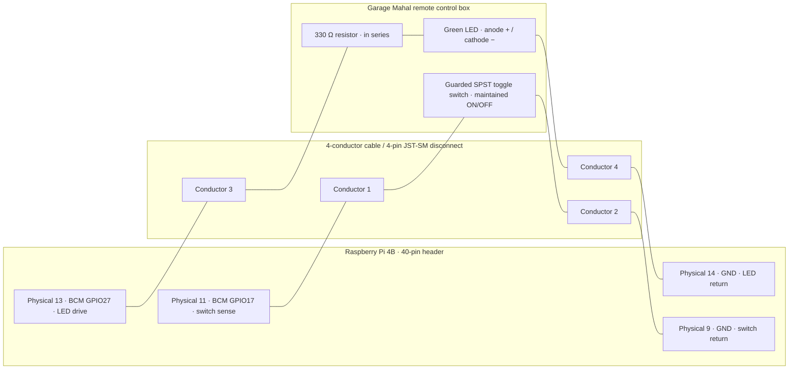

# MiPorkChop 0.1 — Hardware Wiring Diagram

**Status:** Draft for bench assembly and verification. **Hardware:** Raspberry Pi 4 Model B, DaierTek maintained guarded ON/OFF switch, separate green LED, 330 Ω resistor, 4-conductor cable, 4-pin JST-SM disconnect.

> **IMPORTANT:** BCM GPIO numbers are **not** the same as physical header pin numbers. Turn off and unplug the Pi before wiring. Never apply 12 V, 24 V, or mains voltage to GPIO. Verify the switch's actual terminals with a multimeter before connecting it.

## Wiring overview



### Electrical connections

| Function | Raspberry Pi BCM | Physical pin | Cable | Control-box termination |
|---|---|---|---|---|
| Switch sense | GPIO17 | **11** | 1 | One dry-contact switch terminal |
| Switch ground | GND | **9** | 2 | Other dry-contact switch terminal |
| Green LED drive | GPIO27 | **13** | 3 | 330 Ω resistor → LED **anode (+)** |
| Green LED return | GND | **14** | 4 | LED **cathode (−)** |

The switch is an **unpowered dry contact**. GPIO Zero configures GPIO17 with an internal pull-up; closing the switch to ground is interpreted as ON / BOYS ARE BUZZIN'. GPIO27 HIGH lights the green LED through the resistor. The LED indicates the **local software-recognized state**, not proof of cloud delivery.

### Physical header orientation

With the Raspberry Pi 4B's 40-pin header viewed from above, physical pins 1–2 are at one end of the header; odd-numbered physical pins run down one side and even-numbered pins down the other. **Check the Pi 4B pinout and pin-1 orientation before connecting**, especially with the aluminum case partially obscuring the header.

Relevant rows of the physical 40-pin header:

```text
    ODD side                    EVEN side
    pin 9  GND          [ 9] [10] pin 10
    pin 11 GPIO17       [11] [12] pin 12
    pin 13 GPIO27       [13] [14] pin 14 GND
```
Raspberi Pi 4B Pin Out: https://cdn.sparkfun.com/assets/learn_tutorials/1/5/9/5/GPIO.png

### Cable and connector notes

- Use four insulated conductors, preferably flexible stranded 22–24 AWG, approximately 3–6 feet long.
- At the control box, use a cable gland or other strain relief. At the Pi, secure the harness so pulling the cable does not stress the GPIO header.
- The 4-pin JST-SM is **only a detachable inline connector**. A short pigtail and female 2.54 mm Dupont connectors interface with the Pi's male GPIO header.
- **Do not trust conductor colors or connector pin order by appearance.** With both ends disconnected from the Pi, continuity-test each path through the mated JST-SM pair and label it.
- Use the keyed connector only after confirming the complete pin mapping; avoid exposed, uninsulated splices. A 330 Ω resistor may be installed in series on either side of the LED, but the table above specifies the anode side.
- Do not connect any external power to the guarded switch. A high-current rating printed on the switch is a **maximum contact rating**, not a required operating voltage.

### Bench acceptance test (after parts arrive)

1. Power off and unplug the Raspberry Pi. Verify physical pin positions and wire continuity with a multimeter.
2. With the switch **OFF**, check that GPIO17-to-ground is open. With the switch **ON**, check that the two switch terminals are connected. Check that closing the safety cover returns the switch to OFF if the chosen cover supports this.
3. Verify LED polarity and the 330 Ω series resistor before connecting the LED to GPIO27.
4. Boot the Pi with the standard MiPi I Am Responding build; confirm the GPIO Zero dependency is available.
5. Run `python3 src/porkchop.py` manually from the project checkout. Switch OFF → LED OFF; switch ON → LED ON; return OFF → LED OFF.
6. Confirm startup reads the physical switch correctly, including when booting with the switch already ON.
7. Verify clean shutdown and logging. Do not install a boot-time service until the manual test passes.

**Not yet tested on hardware.** This drawing documents the intended v0.1 circuit; the cloud endpoint and administrative override are future work.
